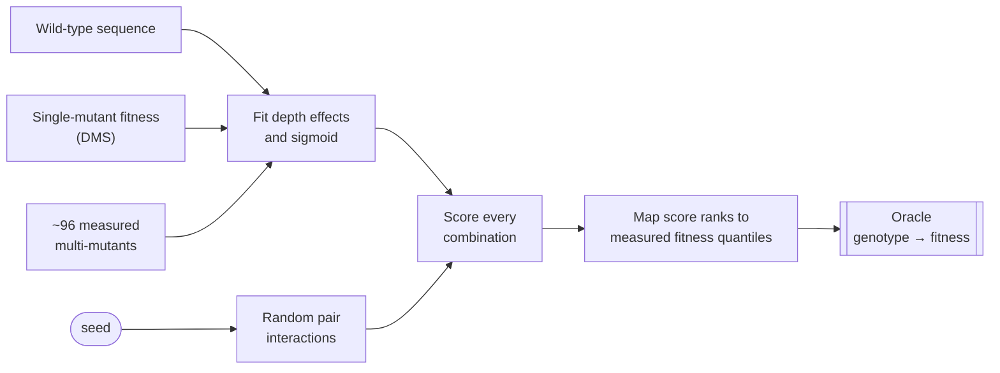

<p align="center">
  
</p>

# mutascape

Synthetic combinatorial protein fitness landscapes, calibrated to measured single mutants and a small sample of multi-mutants.

Machine-learning-guided directed evolution needs combinatorial landscapes to test against, and few proteins have one measured in full.
Mutascape builds a stand-in from the data a lab usually has. You give it a wild-type sequence, a single-mutant scan and around a hundred measured combinations.
It returns a fixed oracle that scores every combination of those mutations, with a fitness distribution that matches your measurements.



WT and single mutants keep their measured values exactly.
Combinations get a synthetic fitness drawn from the measured distribution.
A seed fixes the pair interactions, so each seed gives one reproducible benchmark landscape.

## Installation

Requires Python 3.14+.

```bash
uv sync              # core dependencies
uv sync --extra dev  # + pytest/ruff
```

## Inputs

Two tables on the same assay scale, plus the wild-type sequence.

**Single mutants.** WT and one row per measured substitution. Positions start at 1.

```csv
variant,fitness
WT,1.00
V1A,0.58
V1L,1.10
D2W,1.32
D2G,0.21
G3A,0.95
G3S,1.20
```

**Measured combinations.** Genotypes with two or more substitutions, sampled uniformly from the search space. Every substitution needs a single-mutant row.

```csv
variant,fitness
V1A+D2W,0.91
V1L+G3S,1.45
D2G+G3A,0.05
V1L+D2W,1.50
V1L+D2W+G3S,1.80
V1A+D2G+G3S,0.02
```

**Wild type.** A FASTA file or a plain string, here `VDG`.

## Build and query a landscape

```python
from mutascape import from_dms

generator = from_dms(
    "singles.csv",
    fasta="wild_type.fasta",
    calibration="combinations.csv",
)
oracle = generator.draw(seed=42)

oracle.score_many(["WT", "D2W", "V1L+D2W", "V1L+D2W+G3S", "V1A+D2G"])
```

```text
wt             1.0000   ← measured, kept exactly
D2W            1.3200   ← measured, kept exactly
V1L+D2W        1.6350   ← synthetic
V1L+D2W+G3S    1.9050   ← synthetic
V1A+D2G        0.0095   ← synthetic
```

A different seed gives a different landscape with the same singles and the same fitness distribution.

```python
generator.draw(seed=42)["V1L+D2W+G3A"]   # 1.815
generator.draw(seed=7)["V1L+D2W+G3A"]    # 1.635
```

Mutation labels are case-insensitive and accept `+` or `:` between substitutions.
Each oracle reports its search space through `oracle.domain`.
Repeated queries return the same value, whatever their order or batch size.

Both inputs also accept a pandas DataFrame. Pass a sequence string with `wt_sequence="VDG"` in place of `fasta`.
The [combination-calibration guide](docs/quantile_generator.md) covers the input rules and the quantile map in full.

## Without measured combinations

Leave out `calibration` and Mutascape builds the landscape from WT and singles alone.

```python
generator = from_dms("singles.csv", fasta="wild_type.fasta")
oracle = generator.draw(seed=42)
```

This mode needs no enumeration, so it scales to whole proteins.
It accepts `maximum_depth`, and `complete="esm2"` fills unmeasured substitutions with [ESM-2 estimates](docs/esm_completion.md).
Its combination fitness distribution fits measured data less closely.
See the [singles input guide](docs/singles_generator.md).

## Benchmark a search method

A campaign gives a method a budget, a candidate set and an assay.
The oracle stays private, so a method learns a fitness only by spending budget on it.

```python
from mutascape import run_campaign

candidates = oracle.domain.sample(depth=3, n=5000, seed=0)

def my_method(campaign):
    campaign.measure(campaign.sample(96))          # first plate
    while campaign.remaining:
        design = campaign.encode()                  # one-hot over candidates
        observed = campaign.observed                # variant, fitness, round
        picks = choose_next(design, observed)       # your model goes here
        campaign.measure(picks[: campaign.remaining])

result = run_campaign(
    my_method,
    oracle,
    candidates,
    budget=384,
    batch_size=96,
    noise=0.1,
)
print(result.simple_regret, result.rounds)
```

`batch_size` defaults to 96, one microplate.
`noise` adds assay error in units of the landscape's spread. Each variant keeps its own error, so a repeated read never changes.
Scoring reads the true fitness of the variant with the best read, so a method that chases assay noise pays for it.
`simple_regret` is the gap to the best candidate, scaled by the range of the candidate set.

Run every method on the same candidates and several seeds before you compare them.

## Save a landscape

```python
from mutascape import QuantileCalibratedLandscape

saved = generator.to_dict()
oracle = QuantileCalibratedLandscape.from_dict(saved).draw(seed=42)
```

Store the dictionary and the seed with the benchmark result.
A singles-only oracle writes a manifest instead with `oracle.save_manifest("oracle.json")`, and `load_oracle` restores it.

## Limits

- Mutascape is a benchmark generator. It does not predict the true fitness of unmeasured variants.
- Calibration estimates score percentiles from 100,000 uniformly sampled generated multi-mutants, or uses all multi-mutants in smaller spaces. No default search-space limit applies. Set `draw(seed, reference_size=None)` for exact enumeration.
- Measured combinations shape the fitness distribution but do not keep their exact values.
- Every queried substitution needs a measured single mutant, unless the singles-only mode imputes it with ESM-2.
- A close fitness distribution does not show that the landscape ranks search methods correctly. Confirm conclusions on experimentally measured combinatorial data.

## Further reading

- [Combination-calibration guide](docs/quantile_generator.md)
- [Singles input guide](docs/singles_generator.md)
- [Optional ESM-2 completion](docs/esm_completion.md)
- [Evidence for the manuscript model](docs/evidence.md)
- [Legacy generators, browser studio and archived studies](docs/legacy.md)
