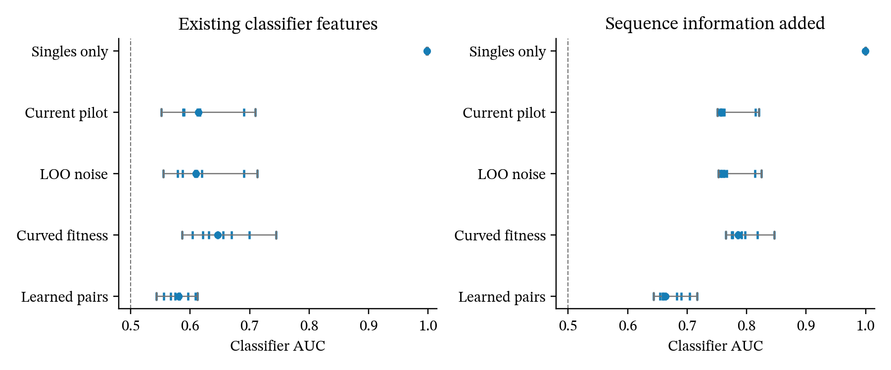

# Three alternatives for CreiLOV classifier agreement

## Main result

Learning pair effects from 48 measured combinations gives the most promising result in this experiment.
It improves the stronger classifier score, fitness-distribution agreement, and variant ranking relative to the existing pilot model.
It does not improve every measure or establish realism on other proteins.

The manuscript's strongest existing result concerns the information supplied by a small combination pilot.
The original singles-only model can reproduce some aggregate features but fails on assay-scale fitness.
Forty-eight combinations greatly reduce that mismatch.
The 89.5 per cent search agreement should remain secondary because a fixed ranking from other proteins reaches 91.9 per cent.

## What the Walsh distance means

The reported distance compares normalised variance fractions across interaction orders.
Zero means identical variance allocation, and two is the maximum distance.
CreiLOV's original median of 0.057 is small for this specific comparison.
Half that distance corresponds to moving 2.85 per cent of total variance between order categories.

This does not establish matching individual interactions or variant fitness.
The binary projection also averages different amino acids at each mutated-site pattern.
Complete-library distances of 0.605 for DHFR and 1.046 for eqFP611 show that agreement does not generalise across the tested proteins.

The new experiment uses same-assay singles for every model.
Its spectral values therefore should not replace the original full-DMS result without explaining the different inputs.

## C2ST is already reported

The manuscript reports C2ST under its adversarial CreiLOV assessment, measured-pilot result, and prospective ParB-Noc result.
The original singles-only CreiLOV model gives AUC above 0.999.
The earlier pilot experiment gives median AUCs of 0.595 and 0.619.
The prospective ParB-Noc values are 0.900 and 0.963.

AUC 0.5 represents chance discrimination, while one represents perfect separation.
The original failure exposes raw fitness error that standardisation and interaction-order spectra can hide.
A score near chance only limits the evidence supplied by the tested classifier and features.
It does not prove that two landscapes are equivalent.
See the [classifier two-sample test paper](https://arxiv.org/abs/1610.06545).

## Fixed experiment

Each model receives the same wild-type and single-mutant fitness values from the combinatorial assay.
Each pilot model also receives the same 48 measured combinations within a split.
The singles-only control receives no combinations.

Three new splits each contain 48 calibration variants and 2,000 evaluation variants.
All six genotype sets are disjoint.
Selection excludes saved variants from earlier pilot and classifier studies, including the earlier 192-variant pilots.
Full-library descriptive analyses have already used aggregate information from this protein.
These are fresh genotype splits within CreiLOV, rather than independent-protein confirmation.

We fixed the three alternatives and their settings before scoring.
Every model uses the same three draw seeds within each split.
Wild type and singles retain their measured fitness exactly.
The new variants remain experimental and do not change the public default.

Logistic regression and histogram gradient boosting use the original seven classifier features.
Measured and synthetic values for each genotype stay together in the same fold.
Five-fold evaluation and training-fold scaling follow the existing audit.
No classifier permutation tests accompany this exploratory comparison.

A separate boosted classifier also receives indicators for the individual substitutions.
This check asks whether the generator matches more than fitness, mutation count, and additive expectation.
We report both feature sets without selecting the more favourable result.

## Three approaches

### 1. Estimate noise from excluded calibration variants

The existing pilot estimates residual variance from the data used to fit its mean.
This can underestimate variation.
The alternative refits the pilot model 48 times, excluding one calibration variant each time.
Prediction errors set the random-pair scale in the full pilot model's latent coordinates.
The mean model and sigmoid stay unchanged.

### 2. Fit curvature directly in fitness units

This alternative removes the sigmoid from the pilot model.
It fits four regularised terms involving mutation count and additive fitness.
Two extra terms allow curvature in those responses.
Ridge penalty ten stays fixed, and excluded-variant errors set the shared random-pair scale.

### 3. Learn pair effects from the pilot

This alternative keeps the existing pilot mean and sigmoid.
It fits Bayesian ridge regression to the remaining latent errors using indicators for pairs of substitutions.
Each draw samples one complete vector of pair coefficients from the fitted coefficient distribution.
This replaces unconditioned random pair effects with effects informed by the 48 calibration measurements.
No extra observation noise enters the fixed oracle.
The [Bayesian ridge documentation](https://scikit-learn.org/stable/modules/generated/sklearn.linear_model.BayesianRidge.html) describes the coefficient distribution and fitted precision parameters.

## Results

Values below are medians across three calibration splits and three draws per split.
Lower classifier AUC and Wasserstein distance indicate closer agreement.
Higher Spearman correlation indicates better ranking of measured variant fitness.
The nine draws share calibration data within each split and are not nine independent biological replicates.

| Model | Logistic AUC | Boosted AUC | Boosted AUC with sequence | Raw Wasserstein | Walsh distance | Variant Spearman |
|---|---:|---:|---:|---:|---:|---:|
| Same-assay singles only | 0.998 | 0.998 | 1.000 | 0.432 | 0.181 | 0.126 |
| Existing pilot | 0.571 | 0.614 | 0.757 | 0.058 | 0.098 | 0.402 |
| Excluded-variant noise | 0.575 | 0.610 | 0.762 | 0.059 | 0.092 | 0.392 |
| Curved fitness model | 0.570 | 0.646 | 0.785 | 0.070 | 0.098 | 0.315 |
| Learned pair effects | 0.573 | 0.581 | 0.663 | 0.041 | 0.059 | 0.698 |

The noise adjustment provides little benefit.
Its small gain on one classifier accompanies worse sequence-aware discrimination and fitness error.
The curved fitness model worsens the stronger classifier result in all nine paired comparisons.

Learned pair effects improve boosted AUC in seven of nine paired comparisons.
They improve sequence-aware boosted AUC in all nine.
Median boosted AUC improves within each of the three calibration splits.
Logistic AUC remains similar and is slightly worse at the overall median.

Raw Wasserstein distance falls by about 28 per cent relative to the existing pilot.
Variant Spearman correlation increases from 0.402 to 0.698.
Higher-order coefficient cosine also increases from approximately zero to 0.232.
That provides some evidence of improved interaction structure, while leaving substantial disagreement.

The learned-pair boosted AUC ranges from 0.543 to 0.612 across the nine outcomes.
Its sequence-aware AUC ranges from 0.643 to 0.717.
The stronger discriminator still detects differences.



Dots show medians, ticks show individual outcomes, and lines span the observed minimum and maximum.
These ranges describe draws and calibration splits, not confidence intervals.
The dashed line marks chance discrimination.

Spectral checks use the full measured library, including calibration rows, and remain descriptive.
Search-method agreement and graph topology have not been evaluated for these new alternatives.
Better C2ST alone does not establish that they are better search benchmarks.

## Recommendation

Continue with learned pair effects while retaining the current pilot as a control.
Test search-method agreement and a second protein before changing the default or the manuscript's main claim.
The current experiment does not justify adopting either of the other alternatives.
The manuscript remains unchanged.

## Reproduction

```sh
OMP_NUM_THREADS=1 OPENBLAS_NUM_THREADS=1 uv run python -m scripts.compare_c2st_alternatives
uv run python -m scripts.summarise_c2st_alternatives
uv run pytest tests/test_c2st_alternatives.py -q
```

The results directory contains the frozen protocol, original experiment source, genotype identities, all predictions, classifier outcomes, and spectral results.
The source copy preserves the exact code hash recorded before scoring.
The maintained script also saves this source copy automatically and rejects unknown model names.
These changes do not alter model fitting or predictions.
Tests check exact measured fitness, deterministic queries, query-order invariance, and agreement with the existing pilot implementation.

## Completed protein-transfer test

The [follow-up report](pair_pilot_transfer_2026-09-23.md) tests DHFR, eqFP611, and ParB-Noc at two calibration budgets.
The CreiLOV classifier gain does not generalise consistently. Keep the learned-pair model experimental.
