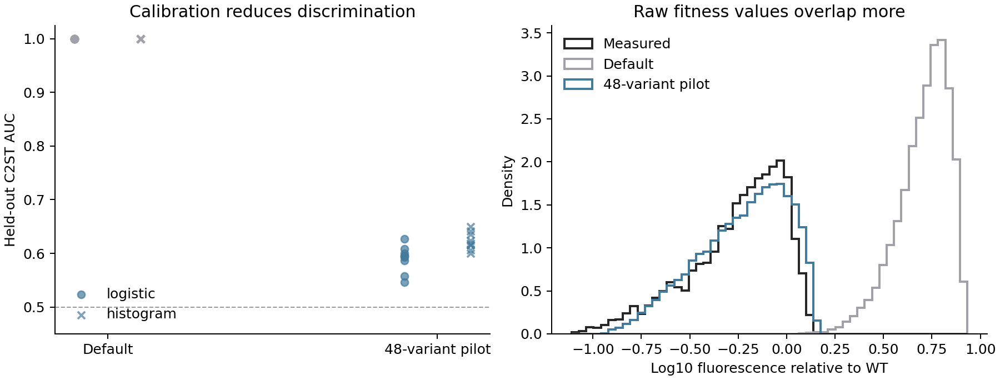

# CreiLOV model diagnosis

Updated 2026-09-09.

## Cause

The raw classifier test detects a large fitness offset.
One saved sample has mean measured fitness of -0.259 and mean synthetic fitness of +0.718.
Standardising each histogram separately removes this offset, so a close standardised histogram does not contradict C2ST.

The input assays also disagree.
The 19 shared single substitutions have Pearson correlation 0.131 between the full DMS and the combinatorial assay.
Their mean effects are 0.148 and 0.027, respectively.
Both values use log10 fluorescence relative to their own measured wild type.
The library-only substitution is V107M. The manuscript previously called it I107M.

The current validation keeps the original DMS value when both assays contain a single substitution.
Replacing those values with same-assay measurements reduces the offset but leaves strong classifier discrimination.
Using only library singles also fails.
Input alignment matters, but it does not resolve the missing combinatorial trend.

The default model draws centred pair interactions around measured single effects.
Most selected singles help fluorescence, yet combinations often reduce it.
A monotonic saturating readout limits large positive sums but does not create a shared negative interaction trend.
Otwinowski et al. describe this distinction between a global readout and specific interactions in
[their global epistasis study](https://pmc.ncbi.nlm.nih.gov/articles/PMC6094095/).

## Experiments

The experiments leave the public generator unchanged.
They keep the logistic and histogram classifiers fixed.
All comparisons retain genotype pairs within the same test fold.

| Experiment | Target combinations used for fitting | Finding |
|---|---:|---|
| Same-assay single substitutions | 0 | Smaller offset, strong discrimination remains |
| Protein-balanced burden transfer | 0 | Better raw calibration, but discrimination remains |
| Two pair-count correction terms | 48 | Much lower C2ST, but excessive upper tails and poor method ordering |
| Pair-count correction with a sigmoid | 48 | Limits the upper tail, but C2ST remains high |
| Per-mutation burden with a sigmoid | 48 | Promising development result, followed by a separate confirmation run |

The pilot model fits two mean terms and one residual scale.
It keeps wild type and measured singles exact.
The burden terms vanish at mutation depths zero and one.
Its seeded pair field shares coefficients across genotypes, so repeated queries define a fixed landscape.
The bounded version fits sigmoid bounds from pilot and single-mutant values, with a five per cent margin.

This changes the input contract.
The pilot model needs a small measured combinatorial batch.
Its results cannot support a claim about generation from singles alone.
It also lacks a public API, manifest support, and a studio control.
It remains an experimental script until validation supports those additions.

## Assessment safeguards

Development compared four fixed model variants.
The final check reserves new genotype samples and new landscape seeds.
It excludes earlier sampled genotypes from the new calibration and classifier samples.
Each split uses 48 calibration variants and 2,000 separate classifier variants.
The samples still come from CreiLOV, so this is no independent-protein validation.

The classifier features match the original audit across all arms.
No test fitness values set model parameters or feature scales.
The report includes both classifiers and every landscape draw.
No permutation p-values accompany the prototype screening results.

The search check uses all 12 methods, 20 search seeds, and 48 queries.
Calibration variants do not enter the search candidate pool.
Method comparisons use paired bootstrap intervals from measured search runs.
Walsh spectra use the full measured library, including the 48 calibration rows, as a descriptive fit check.

## Confirmation results

The final run excluded the earlier 192-variant pilot samples as well as all development classifier samples.
This repairs an omission in the first confirmation split definition.
The model family and its settings did not change after that check.

| Metric | Default generator | Bounded burden prototype |
|---|---:|---:|
| Median logistic C2ST AUC | 1.000 | 0.595 |
| Median histogram C2ST AUC | 1.000 | 0.619 |
| Median raw Wasserstein distance | 0.970 | 0.062 |
| Median raw Wasserstein distance in measured standard deviations | 3.971 | 0.251 |

These medians cover three calibration splits and three landscape draws per split.
Raw distance falls by about 94 per cent.
The classifier can still distinguish the prototype from measured data.
Replicate discrimination does not define an acceptance threshold.

The prototype preserves 348 of 399 scored method-pair comparisons, or 87.2 per cent.
Its median per-draw agreement is 87.0 per cent, with a range of 76.1 to 97.7 per cent.
Pairs recur across draws, so these are not 399 independent observations.
The run makes 2,880 search runs across measured and synthetic arms.

Median Walsh distance is 0.069.
This describes interaction-order variance, not agreement between individual Fourier coefficients.
The corresponding higher-order coefficient cosine remains near zero.
The prototype reproduces some aggregate properties without predicting the measured genotype map.



The figure includes all nine synthetic draws and three held-out genotype samples.
Histogram curves pool those samples. They do not show biological uncertainty intervals.

## Reproduction commands

```sh
uv run python scripts/diagnose_creilov_anchors.py
uv run python scripts/diagnose_transfer_burden.py
uv run python scripts/assess_creilov_pilot.py
uv run python scripts/assess_creilov_pilot.py --readout
uv run python scripts/assess_creilov_pilot.py --burden
uv run python scripts/assess_creilov_pilot.py --burden --readout
uv run python scripts/assess_creilov_pilot.py --burden --readout --confirm
uv run python scripts/replay_c2st_audit.py results/creilov_pilot_readout_burden_confirmation
uv run python scripts/plot_creilov_pilot_assessment.py
```

The confirmation command needs the first assessment's saved samples to exclude development genotypes.
The scripts read the existing local benchmark data and cached prior from the original C2ST audit.

## Locations

| Location | Contents |
|---|---|
| `codex/creilov-adversarial-model` | Current branch in the main checkout |
| `scripts/assess_creilov_pilot.py` | Model variants, classifier checks, search runs, and spectra |
| `results/creilov_pilot_readout_burden_confirmation/` | Final samples, model settings, metrics, and figure |
| `.mutascape/experiments/creilov_anchors/` | Same-assay comparison and single-effect agreement |
| `.mutascape/experiments/transfer_burden/` | Protein-balanced transfer experiment without target combinations |
| `.mutascape/experiments/refactor_c2st_check/` | Regenerated original audit after the import refactor |

The working tree also contains the other agent's uncommitted refactor.
No commit combines that work with these experiments.

## Refactor review

The import refactor preserves all regenerated oracle values, feature matrices, and 48 original C2ST scores exactly.
The Python suite passed 543 tests, including the developer-command regression test.
The web suite passed 34 tests, and lint, type checks, documentation checks, and the build passed.

Two developer commands still referenced deleted files.
The review removed those obsolete commands and added a test for missing script targets.
It also fixed nested tooltip buttons and added a regression assertion.
The other agent's source edits and staged deletions remain intact.
