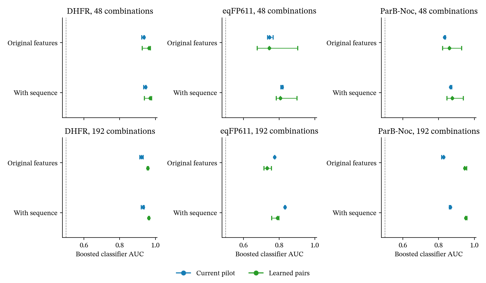

# Learned pair effects across three further proteins

## Recommendation

Keep learned pair effects experimental. Do not replace the current generator or make general classifier improvement the manuscript's headline.
The CreiLOV gain does not persist across the three further proteins at the same calibration budget.
With more measurements, eqFP611 shows a repeatable benefit. DHFR and ParB-Noc remain easy to distinguish from measured landscapes.

The manuscript should include this extension and its limits as an experimental result.
Its central claim should concern the value of measured combinations, with separate checks for fitness agreement and search behaviour.
These results do not support a general claim that learning pair effects improves benchmark validity.
The manuscript and public generator remain unchanged.

## Fixed comparison

The experiment tests DHFR, eqFP611 red fluorescence, and ParB-Noc.
Their complete libraries contain 8,000, 8,192, and 160,000 variants respectively.
Every model receives wild-type and single-mutant fitness from the same assay as its evaluation data.
No transferred protein prior enters the new pair model.

The primary comparison gives each model 48 measured combinations.
A second comparison gives each model 192 combinations, including the original 48.
Three random splits each reserve 2,000 separate combinations for evaluation.
All six calibration and evaluation sets within a protein are disjoint.
The two calibration budgets share evaluation sets, so their comparison uses the same genotypes.

The model settings match the earlier CreiLOV experiment.
The current pilot fits a sigmoid readout and two terms based on mutation count and additive fitness.
The alternative fits Bayesian ridge regression to the remaining latent errors using indicators for substitution pairs.
Each generated landscape samples one shared vector of pair coefficients.
The readout and fitted hyperparameters stay fixed within a split.
These coefficient draws do not include full parameter uncertainty or an assay-noise model.

A control uses the fitted pair means without random draws.
An additive control uses measured singles without combination calibration.
The two stochastic models each have three draws per split.
The protocol records all genotype selections and settings before scoring.
These proteins appeared in earlier project audits, although they did not develop this pair-learning model.
This experiment tests the procedure after calibration on each protein. It does not test prediction without protein-specific measurements.

## Classifier results

The table reports median AUC across nine outcomes per stochastic model.
AUC 0.5 indicates chance discrimination and one indicates perfect discrimination.
The models face logistic regression and histogram gradient boosting with five paired genotype folds.
A second boosted classifier also receives individual substitution indicators.
The classifiers use the same features, folds, and settings for both models.

| Protein | Calibration combinations | Current pilot AUC | Learned pair AUC | Current pilot AUC with sequence | Learned pair AUC with sequence |
|---|---:|---:|---:|---:|---:|
| DHFR | 48 | 0.935 | 0.964 | 0.945 | 0.971 |
| eqFP611 | 48 | 0.746 | 0.745 | 0.816 | 0.811 |
| ParB-Noc | 48 | 0.834 | 0.860 | 0.867 | 0.877 |
| DHFR | 192 | 0.929 | 0.957 | 0.936 | 0.963 |
| eqFP611 | 192 | 0.775 | 0.733 | 0.832 | 0.781 |
| ParB-Noc | 192 | 0.828 | 0.947 | 0.865 | 0.951 |

At 48 combinations, learned pairs improve the original boosted classifier in two of nine DHFR comparisons and three of nine ParB-Noc comparisons.
eqFP611 improves in five of nine, with large variation between calibration splits.
This does not establish a repeatable gain at that budget.

At 192 combinations, eqFP611 improves in all nine comparisons under both boosted classifiers.
DHFR and ParB-Noc worsen in all nine comparisons under the original boosted classifier.
The logistic classifier gives mixed results and does not reverse this conclusion.
All logistic results remain in the saved comparison table.



Each tick shows one calibration split's median across its three draws.
Points show the median of those three split medians. Error bars span their minimum and maximum.
They describe variation between calibration splits, not confidence intervals or biological replication.
The table uses medians across all nine outcomes, which can differ slightly from the plotted centres.

## Fitness and interaction structure

Learning pair effects improves variant ranking on all three proteins relative to the current pilot.
Distribution distance improves for DHFR and ParB-Noc at both calibration budgets.
eqFP611 improves on that measure only with 192 combinations.

The distribution distance below is Wasserstein distance divided by the measured test-set standard deviation.
Each entry shows the current pilot followed by learned pairs.
Walsh distance uses the complete library and includes calibration genotypes.
For DHFR and ParB-Noc, the decomposition retains the full amino-acid alphabets through categorical ANOVA.
eqFP611 uses the binary Walsh transform directly. None of these spectra needs missing-value filling.

| Protein | Combinations | Scaled distribution distance | Variant Spearman | Walsh distance |
|---|---:|---:|---:|---:|
| DHFR | 48 | 0.318 to 0.277 | 0.325 to 0.413 | 0.227 to 0.473 |
| eqFP611 | 48 | 0.308 to 0.328 | 0.254 to 0.465 | 0.429 to 0.663 |
| ParB-Noc | 48 | 0.496 to 0.333 | 0.276 to 0.321 | 0.694 to 0.670 |
| DHFR | 192 | 0.307 to 0.253 | 0.317 to 0.417 | 0.181 to 0.437 |
| eqFP611 | 192 | 0.309 to 0.277 | 0.308 to 0.515 | 0.450 to 0.462 |
| ParB-Noc | 192 | 0.422 to 0.308 | 0.239 to 0.399 | 0.672 to 0.973 |

Walsh distance worsens in five of six comparisons, despite better agreement between signed higher-order effects.
Variance allocation and interaction identity therefore give different answers.

The complete measured eqFP611 library has 193 strict local peaks. Learned-pair landscapes have a median of two with 48 combinations and three with 192.
ParB-Noc has 570 measured peaks, compared with five and one respectively.
Assay noise can contribute measured peaks. These counts still expose a large difference in the resulting search spaces.
DHFR has three measured peaks, compared with two and three under learned pairs.

## Search-method agreement

The experiment ran all 12 existing search methods with ten random seeds at budgets of 48 and 96 queries.
It used three calibration splits and three landscape draws per stochastic model.
The measured controls ran once per split and search seed.
The primary checks produced 15,120 search trials.
A secondary extension repeated every search with 192 calibration combinations after the classifier results.
Together the two calibration budgets produced 30,240 search trials.

Each search space contains all measured combinations except that split's calibration genotypes.
Wild type and singles are also excluded.
Methods search the same genotypes under every model and use matched random seeds.
The calibration data fit the generator but do not initialise the search methods.
The combination-measurement cost is the calibration budget plus 48 or 96 search queries, beyond wild type and singles.

A method comparison counts only when its paired bootstrap interval on measured searches excludes zero.
The score measures how often generated landscapes reproduce that measured winner.
For each method, the stochastic models average regret across three draws before predicting winners.
The first table uses 48 calibration combinations and pools counts across calibration splits.
Repeated method pairs across splits are not independent biological evidence.

| Protein | Search queries | Current pilot | Learned pairs | Fixed ranking from the other two proteins |
|---|---:|---:|---:|---:|
| DHFR | 48 | 40/47, 85.1% | 38/47, 80.9% | 44/47, 93.6% |
| DHFR | 96 | 75/76, 98.7% | 74/76, 97.4% | 72/76, 94.7% |
| eqFP611 | 48 | 21/30, 70.0% | 21/30, 70.0% | 27/30, 90.0% |
| eqFP611 | 96 | 51/53, 96.2% | 50/53, 94.3% | 51/53, 96.2% |
| ParB-Noc | 48 | 113/113, 100% | 113/113, 100% | 106/113, 93.8% |
| ParB-Noc | 96 | 135/135, 100% | 134/135, 99.3% | 121/135, 89.6% |

Learned pairs improve none of these six comparisons. Two tie and four decline.
Median Kendall correlations improve in one comparison, tie in one, and decline in four.
The fixed ranking excludes the target protein but uses measured searches from the other two proteins in this experiment.
It is a diagnostic comparator, not a separately frozen external result.
The secondary search results below use 192 calibration combinations.
They test whether the larger calibration budget changes the conclusion.

| Protein | Search queries | Current pilot | Learned pairs | Fixed ranking from the other two proteins |
|---|---:|---:|---:|---:|
| DHFR | 48 | 72/75, 96.0% | 71/75, 94.7% | 73/75, 97.3% |
| DHFR | 96 | 57/57, 100% | 52/57, 91.2% | 54/57, 94.7% |
| eqFP611 | 48 | 33/40, 82.5% | 31/40, 77.5% | 39/40, 97.5% |
| eqFP611 | 96 | 37/40, 92.5% | 33/40, 82.5% | 37/40, 92.5% |
| ParB-Noc | 48 | 90/99, 90.9% | 93/99, 93.9% | 98/99, 99.0% |
| ParB-Noc | 96 | 140/143, 97.9% | 135/143, 94.4% | 120/143, 83.9% |

The larger pilot does not produce a consistent search benefit.
eqFP611 loses method-winner agreement at both search budgets despite its better classifier results.
Across both calibration budgets, learned pairs improve winner agreement once, tie twice, and decline nine times.
These twelve comparisons share proteins and are descriptive, rather than twelve independent replications.
Excluding more calibration genotypes changes the search domain slightly, so comparisons between calibration budgets have that extra difference.

## What explains the mixed result

The calibration design covers different fractions of the possible substitution pairs.
With 48 combinations, DHFR observes a median of 132 of 1,083 pairs. ParB-Noc observes 241 of 2,166.
eqFP611 observes all 78 pairs, although 48 rows cannot identify 78 separate coefficients without regularisation.
With 192 combinations, its pair-design matrix has full column rank.
These differences help explain why a fixed measurement count is not equally informative across proteins.
They do not establish a causal explanation for every result.

The fitted regularisation also shrinks most DHFR pair means close to zero.
ParB-Noc shows similar shrinkage with 192 combinations.
Some predictive gains therefore come from reducing random interactions rather than learning many distinct pair effects.
The fitted-mean control improves ranking further in several cases but often worsens classifier discrimination.
Removing variation can help prediction while making a poor generator.

ParB-Noc assigns exactly the same recorded fitness to 49.6 per cent of variants.
The present continuous readout does not reproduce that point mass.
DHFR also concentrates much of its measured distribution in a narrow low-fitness region.
These features motivate a separate assay-observation model, rather than further tuning pair effects against C2ST alone.

## Manuscript decision and next work

Add the CreiLOV result together with this cross-protein test as a limited experimental extension.
Report the eqFP611 gain at 192 combinations and the failures on DHFR and ParB-Noc.
Keep fitness prediction, interaction structure, and search agreement as separate outcomes.
Do not claim that the new model generally improves benchmark validity.

The next model experiment should address assay observations and the amount of pair information in the calibration set.
Fit any observation model using calibration data only, then test it on new genotype splits.
Select calibration variants to cover substitution pairs instead of relying only on uniform sampling.
Neither change has supporting results from this experiment yet.

## Reproduction and checks

The frozen protocol, source copies, fitted coefficients, predictions, and all search trials are under `results/pair_pilot_transfer_20260923/`.
One recorded implementation repair copies a read-only search mask before mutation.
The initial search attempt failed before writing scores. The repair changed no model, split, or search setting.
The saved amendment records the revised code hashes and the later secondary search extension.
Post-result topology and coefficient diagnostics did not change any fitted model.

```sh
OMP_NUM_THREADS=1 OPENBLAS_NUM_THREADS=1 uv run python -m scripts.test_pair_pilot_transfer --jobs 3
OMP_NUM_THREADS=1 OPENBLAS_NUM_THREADS=1 uv run python -m scripts.run_pair_pilot_search --jobs 4
OMP_NUM_THREADS=1 OPENBLAS_NUM_THREADS=1 uv run python -m scripts.run_pair_pilot_search --pilot-size 192 --jobs 4
OMP_NUM_THREADS=1 OPENBLAS_NUM_THREADS=1 uv run python -m scripts.diagnose_pair_pilot_transfer
uv run python -m scripts.summarise_pair_pilot_transfer
uv run pytest tests/test_pair_pilot_transfer.py -q
```

The tests compare the new runner against the original CreiLOV implementation and check exact measured values and query-order invariance.
They also check coefficient uncertainty in unmeasured directions and strict local-peak counting.
The audit checks all 432 classifier outcomes, 144 spectra, 30,240 search trials, and the disjoint genotype selections.

The full checks passed with 559 Python tests and 34 web tests. Ruff, Biome, type checks, and the web build also passed.

## Distribution-calibration follow-up

The [next experiment](quantile_calibration_2026-09-23.md) improves the three main classifier failures through distribution calibration.
It retains average search agreement but exposes a DHFR spectral trade-off.
