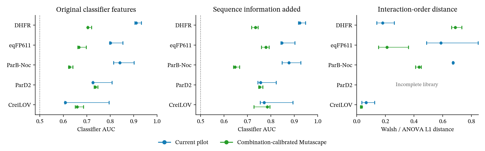

# Distribution calibration improves the main classifier failures

## Result and recommendation

The manuscript presents the distribution-calibrated pilot as Mutascape.
The Python import remains in `mutascape.experimental`, while existing singles-only interfaces retain their behaviour.
It improves both boosted classifiers on DHFR, eqFP611, and ParB-Noc with 192 measured combinations.
All 18 matched comparisons improve across these proteins, three draws, and two classifier feature sets.
The model also reduces fitness-distribution distance on all five confirmation proteins.

This is a useful improvement over the current pilot. It does not solve every aspect of landscape realism.
CreiLOV's boosted classifier scores worsen, and DHFR's interaction-order spectrum moves further from the measured spectrum.
The model preserves average search-method agreement, but its gains on that measure are small.

The manuscript reports its five-protein comparison and states the measurement cost.
It does not claim universal landscape fidelity.
The original singles-only study remains a labelled reference-generator comparison.

## What changed

The previous approach estimated more pair coefficients but retained the same rigid fitness readout.
That could improve variant ranking while leaving the fitness distribution wrong.
The retained model changes how generated ranks map to measured fitness values.

First, it fits the existing pilot generator using same-assay singles and measured combinations.
For each draw, it enumerates the supported combination library and records the generated fitness distribution.
It then maps each generated percentile to the corresponding measured pilot quantile.
This retains the ordering among combinations, except where repeated measured values introduce ties.
Wild type and singles retain their measured values exactly.

The pilot must sample the intended library uniformly.
A pilot selected only for high fitness would bias this distribution estimate.
The map uses calibration measurements and generated scores. It never uses unknown test fitness.
Repeated measured values retain their full empirical probability mass.
Other intervals use linear quantile interpolation, with linear tails to avoid artificial plateaux at the extremes.

This adapts the separation of marginal distributions and dependence used by [copula processes](https://arxiv.org/abs/1006.1350).
It is standard distribution calibration applied to a fixed protein-landscape generator, rather than a claim of a new statistical theory.
The oracle is deterministic for its seed and does not redraw fitness on repeated queries.

## Ideas tested

The development experiments compared distribution remapping with Gaussian processes over genotype space.
The latter used a categorical covariance kernel and conditioning on ranked calibration fitness.
Recent [epistatic Gaussian-process work](https://elifesciences.org/reviewed-preprints/108964v1) motivated this alternative.
Those models improved some classifiers but often introduced too much high-order variation.

Further experiments tested preservation of the original high-fitness tail and three conditional distribution forests.
The forests followed the conditional-distribution idea in [quantile regression forests](https://www.jmlr.org/beta/papers/v7/meinshausen06a.html).
Their random fields used pair effects, independent genotype effects, or a mixture.
These alternatives produced mixed structural results and did not displace the simpler confirmed model.
The development directories retain every tested candidate and its scores.

A [previous study of regression bias](https://pmc.ncbi.nlm.nih.gov/articles/PMC4050575/) also motivated checks beyond predictive error.
It documents how fitted landscapes can distort epistasis and adaptive paths.
The present tests therefore include interaction spectra and search-method comparisons alongside C2ST.

## Confirmation design

The protocol fixed the model and evaluation rules before confirmation scores.
It selected one calibration set and one evaluation set for each of five proteins.
The calibration budgets were 48 and 192 combinations, with the smaller pilot nested inside the larger one.
Each evaluation set contains 1,000 separate combinations.
Three fixed generator seeds give three outcomes per model and calibration budget.
These are conditional draws, not three biological replicates or three independent calibration sets.

DHFR, eqFP611, and ParB-Noc exclude every calibration and evaluation genotype from the previous transfer experiment.
ParD2 did not select this model and supplies an additional protein test.
CreiLOV excludes the earlier recorded samples and reconstructed historical pilots.
All five proteins appeared in earlier project work. These are fresh genotype tests, not wholly unstudied protein families.

The final audit found four historical CreiLOV overlaps outside the saved pilot manifests.
One occurred in the 192-combination calibration set and three in its evaluation set.
A fixed genotype-only rule replaced those four rows before the final results below.
The model settings did not change. The original outputs remain archived beside the repair record.
The 48-combination predictions remained identical, so their search results required no rerun.
The repaired 192-combination model and its search trials ran again.

C2ST uses logistic regression and histogram gradient boosting with five paired genotype folds.
A second boosted classifier receives sequence indicators as well as the original assay features.
A distribution-only control assigns fitness independently of genotype, apart from the measured wild type and singles.
It tests whether better marginal agreement alone explains the apparent benefit.

## Classifier results

The table shows medians across three draws with 192 calibration combinations.
AUC 0.5 indicates chance discrimination and one indicates perfect discrimination.
Both models receive exactly the same measurements.

| Protein | Original features, current pilot | Original features, calibrated | Sequence added, current pilot | Sequence added, calibrated |
|---|---:|---:|---:|---:|
| DHFR | 0.911 | 0.705 | 0.923 | 0.734 |
| eqFP611 | 0.801 | 0.667 | 0.847 | 0.779 |
| ParB-Noc | 0.842 | 0.626 | 0.877 | 0.647 |
| ParD2 | 0.726 | 0.736 | 0.756 | 0.752 |
| CreiLOV | 0.609 | 0.659 | 0.771 | 0.785 |

The three target proteins improve under both feature sets.
ParD2 changes little overall, while CreiLOV worsens under both boosted classifiers.
Across the five proteins, mean original-feature AUC falls from 0.778 to 0.679.
Mean sequence-aware AUC falls from 0.835 to 0.739.
These averages give each protein equal weight and do not hide the two counterexamples above.

With 48 calibration combinations, the same three target proteins improve under both boosted classifiers.
CreiLOV and ParD2 worsen. Larger pilots give better overall distribution estimates, but neither budget guarantees improvement on every protein.
The saved comparison table includes every logistic score and both calibration budgets.



Points show medians across three draws. Error bars span their observed minimum and maximum.
They are not confidence intervals. Each protein has one new calibration set.
The spectrum panel uses a binary projection for CreiLOV and complete factorial decompositions for the other reported proteins.

## Fitness distribution and interaction structure

Wasserstein distance below is divided by the measured evaluation-set standard deviation.
Each entry compares the current pilot with the distribution-calibrated model at 192 combinations.

| Protein | Scaled distribution distance | Walsh distance |
|---|---:|---:|
| DHFR | 0.318 to 0.190 | 0.181 to 0.688 |
| eqFP611 | 0.371 to 0.051 | 0.587 to 0.211 |
| ParB-Noc | 0.441 to 0.110 | 0.673 to 0.436 |
| ParD2 | 0.182 to 0.103 | Not reported |
| CreiLOV | 0.327 to 0.082 | 0.066 to 0.033 |

Mean scaled distribution distance falls from 0.328 to 0.107, a reduction of about 67 per cent.
Variant Spearman correlations remain almost unchanged because the map preserves ordering among combinations.
Changes in ParB-Noc arise from the added ties that reproduce repeated recorded fitness values.

Walsh distance improves for eqFP611, ParB-Noc, and CreiLOV, but worsens substantially for DHFR.
Sparse calibration data estimate the main fitness distribution better than they estimate rare, high-fitness values that contribute strongly to variance.
That is a plausible explanation for the DHFR trade-off, rather than a proven causal result.
The extra tail-preservation experiment did not establish a general solution.

These spectra use the full libraries, including calibration genotypes, and remain descriptive.
DHFR and ParB-Noc retain their full amino-acid alphabets through categorical ANOVA.
eqFP611 uses the binary Walsh transform directly.
CreiLOV uses the earlier binary projection with the same missing-cell treatment.
ParD2 has missing genotypes, so the table makes no filled-spectrum claim for it.

The distribution-only control has near-zero variant rank correlation and much worse spectral agreement.
It can nevertheless match or beat the calibrated model on C2ST for individual proteins.
That result reinforces the need to assess genotype structure separately from adversarial classification.

## Search checks

The experiment completed 16,800 search trials across all 12 existing methods.
It used ten search seeds, two query budgets, two calibration budgets, and three draws per generated model.
Measured controls ran once per protein, calibration budget, and search seed.
Search spaces exclude the calibration combinations and all known singles.
Methods receive the same searchable genotypes and random seeds under every model.
The full measurement cost includes calibration combinations plus search queries, beyond wild type and singles.

A method comparison counts when the paired bootstrap interval on measured searches excludes zero.
The score records how often generated landscapes reproduce that measured winner.
The stochastic models average each method's regret across draws before comparing methods.
Each protein and query budget receives equal weight in the summary.

| Calibration combinations | Mean winner agreement, current pilot | Mean winner agreement, calibrated | Mean Kendall correlation, current pilot | Mean Kendall correlation, calibrated |
|---|---:|---:|---:|---:|
| 48 | 96.1% | 96.7% | 0.603 | 0.634 |
| 192 | 93.7% | 94.3% | 0.628 | 0.653 |

Across the twenty protein, calibration-budget, and query-budget comparisons, winner agreement improves four times, ties twelve times, and declines four times.
Both calibration budgets pass the recorded criterion for average search agreement.
The fixed ranking from other proteins reaches 91.6 per cent agreement at 48 calibration combinations and 88.9 per cent at 192.
These percentages describe this panel and its reliable method comparisons. They do not establish a general ranking advantage.

The changes support preservation of search behaviour, rather than a large improvement in ranking search methods.
The fixed-ranking control uses measured searches on the other four proteins and excludes the target protein.
It is a diagnostic comparison within this panel.
The small sample of proteins does not support a general superiority claim.

## Implementation and reproducibility

The generator is available as `mutascape.experimental.QuantileCalibratedLandscape`.
The [API guide](quantile_generator.md) describes its inputs, saved parameters, and query behaviour.
The documentation site includes the same public API.
The singles-only API default remains unchanged for compatibility.
The manuscript uses the quantile model and includes C2ST, spectra and search results.

Development outputs are in `results/copula_development_20260923/` and `results/conditional_development_20260923/`.
Confirmation outputs are in `results/quantile_confirmation_20260923/`.
They include the frozen source, protocol, genotype identities, predictions, fitted models, and all search trials.
The CreiLOV repair has a separate record and preserves the original results.

```sh
OMP_NUM_THREADS=1 OPENBLAS_NUM_THREADS=1 uv run python -m scripts.confirm_quantile_pilot --jobs 3
OMP_NUM_THREADS=1 OPENBLAS_NUM_THREADS=1 uv run python -m scripts.run_quantile_search --jobs 4
uv run python -m scripts.summarise_quantile_confirmation
uv run python -m scripts.audit_quantile_splits
uv run python -m scripts.plot_quantile_confirmation
```

Tests check exact measured values, query-order invariance, saved-model restoration, and agreement with the existing pilot before calibration.
They also check monotonicity, repeated-value mass, tail interpolation, and the enumeration limit.
The full suite passed with 561 Python tests and 34 web tests.
Ruff, Biome, type checks, documentation assets, and the web build passed.

## Standard-generator comparison

A further comparison uses the same five proteins, candidate sets, query budgets and search seeds as the 192-combination model.
Additive uses measured singles and one fixed landscape.
Potts and RMF use measured singles and three draws.
Their coupling and roughness remain 0.25 and 1.0, respectively.
NK uses independent Gaussian lookup tables with one or two random neighbours per site and no target fitness.
Every stochastic generator uses three draws.
These controls use fewer target measurements than Mutascape.

| Generator | Mean Kendall correlation | Mean pair agreement |
|---|---:|---:|
| Mutascape | 0.653 | 94.3% |
| Additive | 0.584 | 92.6% |
| Potts | 0.613 | 94.7% |
| RMF | 0.541 | 87.9% |
| NK K=1 | 0.555 | 93.4% |
| NK K=2 | 0.314 | 71.4% |

Each mean weights five proteins and two query budgets equally.
No generator leads every metric or protein.
The results describe the tested settings without establishing superiority across new proteins.

`scripts/compare_quantile_generators.py` records the protocol and reproduces the additional controls.
The result directory is `results/quantile_generator_comparison_20260923`.
The publication summary is `src/mutascape/data/validation/quantile-confirmation-v1.json`.
It contains per-protein results, controls, input hashes and the split audit.
