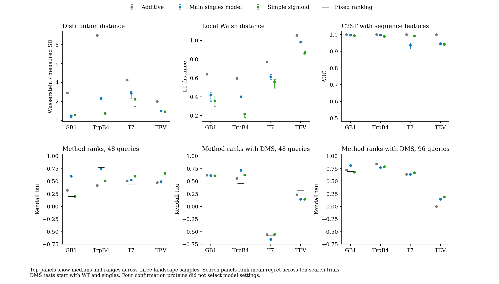

# Returning to a simple DMS generator

## Recommendation

Restore singles-only generation as the core of Mutascape.
Keep the combination-pilot model as an optional extension with a separate input requirement.
The original idea remains useful for synthetic benchmark experiments.
These experiments do not establish a reliable way to reconstruct a particular protein's unmeasured landscape.

The new sigmoid prototype offers a much smaller model without a donor prior.
It preserves every supplied single and supports arbitrary combinations of those substitutions.
Its search-ranking agreement is close to the current singles model.
Its local interaction spectra are closer to the measured spectra on all four confirmation proteins.
However, classifiers still distinguish its outputs from measurements easily.
I recommend the prototype as the basis for simplification, with interaction strength retained as a benchmark setting.

## What changed in the project

The original technical note proposed DMS singles and a WT sequence as sufficient inputs.
It added optional structure or sequence-derived interactions and a fitness transformation.
That input requirement remains in the public `from_dms` API on main.

The current manuscript instead presents `QuantileCalibratedLandscape` as the main generator.
That model needs measured combinations from the target assay.
Its better distribution results therefore do not validate the original singles-only premise.
The manuscript focus changed, although the code retained the earlier capability.

The original note also selected interaction strength through comparisons with measured landscapes.
Its agreement claims already depended on those validation choices.
Returning to its input requirement does not require repeating its validation claims.

## What singles can tell us

For two binary mutations, an additive model has fitness `f0 + a*x1 + b*x2`.
Adding `c*x1*x2` leaves WT and both singles unchanged for every value of `c`.
The double mutant can therefore have many different fitness values with exactly the same inputs.
More sites introduce more unknown interaction terms.

This ambiguity permits a family of synthetic benchmarks with known assumptions and adjustable difficulty.
It prevents a general guarantee that singles determine the true combinations or the best search method for that protein.

Structure supplies possible contact relationships.
It does not specify assay fitness, single-mutant effects or interaction signs by itself.
A structure-only generator therefore needs synthetic fields, a physical score or another source of mutation effects.
Its arbitrary units should not enter a raw assay-scale comparison.

[SLIP](https://doi.org/10.1101/2022.10.28.514293) provides a useful precedent for synthetic environments with adjustable search difficulty.
It uses sequence-family statistics and tuned Potts models.
Its purpose supports this benchmark framing, but it does not validate our particular generator.

## A small replacement model

The prototype contains three short model variants.

| Variant | Combination rule |
|---|---|
| Linear | Sum measured single effects and fixed random pair effects |
| Sigmoid | Transform singles, sum their effects and random pairs, then map back to fitness |
| Pool | Combine positive and negative effects through separate Euclidean norms, then add random pairs |

The sigmoid model uses this expression.

```text
effect_i = measured_single_i - measured_WT
latent_i = inverse_g(effect_i)
fitness(x) = measured_WT + g(sum(latent_i) + strength * single_SD * sum(pair_ij))
```

Here `g(0) = 0`, and `single_SD` describes the latent single effects.
Each pair coefficient has unit marginal variance and stays fixed for a seed.
The WT-centred pair construction makes its contribution vanish for WT and singles.
Related combinations share coefficients.
Queries do not sample fresh noise or enumerate the library.

The sigmoid limits extend 5% beyond the range of WT and supplied singles.
The selected pair strength is 0.3.
Both settings came from development proteins, without fitting target combinations during construction.
The prototype needs no empirical donor prior, quantile mapping or pilot.
Optional contacts restrict which pairs contribute.

[Otwinowski, McCandlish and Plotkin](https://pmc.ncbi.nlm.nih.gov/articles/PMC6094095/) motivate nonlinear mappings from latent additive traits.
Their work supports this model class.
Our fixed sigmoid limits and random interactions remain modelling assumptions, rather than inferred biophysical parameters.

The research API accepts WT and singles in `mutations` and `fitness` columns.
Every queried substitution must have a supplied single measurement.

```python
from mutascape.experimental.singles import SimpleLandscape

landscape = SimpleLandscape.from_singles(
    sequence,
    singles,
    seed=42,
    strength=0.3,
)
fitness = landscape["A102G+P20Y"]
```

The query assumes those residue positions match the supplied sequence and singles.
A test also queries three mutations from a library with `2**100` possible genotypes.
The constructor rejects combination measurements.

## Evaluation

Five development proteins selected settings within each model family.
They were DHFR, eqFP611, ParB-Noc, ParD2 and CreiLOV.
The search compared 16 settings through distribution and local Walsh distances.
It selected pair strengths of 1.0 for linear and 0.3 for both other families.

GB1, TrpB4, T7 and TEV then supplied confirmation measurements.
They did not select these settings.
They appeared in earlier project work, so this is not a new independent collection.
Every target generator received only WT and same-assay singles.

The main-model control uses the existing implementation and its default pair coupling.
Its prior excludes the target and uses development proteins only.
This tests the main generator fairly, rather than copying numbers from an overlapping bundled prior.
All 2,700 sampled vectorised predictions matched its public oracle to an absolute tolerance of 1e-12.

The full comparison contains 45,360 search runs across nine proteins.
It uses all 12 methods, ten search trials and budgets of 48 and 96 queries.
A further 11,760 runs test campaigns that already hold WT and single-mutant observations.
Those campaigns spend their new budget on combinations only.
All runs in the DMS-led test used their full query budget.

The DMS-led test followed inspection of the first search results.
It retained the selected generator settings and tested all four confirmation proteins.
Measured searches on the five development proteins supplied its fixed-ranking control.
That control chooses a method ordering without generating a target landscape.

Distribution checks use 1,000 measured multi-mutants per protein.
Grouped five-fold C2ST keeps each genotype's real and synthetic observations together.
It tests assay features both with and without sequence indicators.
The table below reports the sequence-based diagnostic.
C2ST here is an effect-size check, without permutation p-values.

Walsh checks use 256 complete measured three-site subcubes per protein.
The calculation pools coefficient energy across subcubes and reports variance at orders one, two and three.
It neither fills missing genotypes nor merges amino-acid identities.
This gives ParD2 a valid local spectrum despite its incomplete full library.
These distances differ from the earlier full-library and CreiLOV projected spectra.

## Results

Each distribution result first takes the median across landscape samples, then averages the four confirmation proteins equally.
Lower distribution and Walsh distances mean closer agreement.
C2ST approaches 0.5 when the classifier cannot distinguish the samples.

| Generator | Wasserstein / measured SD | Local Walsh L1 | C2ST AUC |
|---|---:|---:|---:|
| Additive | 4.534 | 0.766 | 1.000 |
| Linear with pairs | 5.894 | 0.628 | 0.976 |
| Pool | 2.408 | 0.685 | 0.953 |
| Main singles model | 1.662 | 0.604 | 0.969 |
| Simple sigmoid | 1.116 | 0.500 | 0.979 |
| Simple sigmoid with contacts | 1.111 | 0.512 | 0.982 |

The simple sigmoid reduces mean distribution distance by 33% relative to the main singles control.
Mean local Walsh distance decreases by 17%.
Its distribution distance improves on three of four confirmation proteins.
Its local Walsh distance improves on all four.
Its C2ST score remains poor and is slightly worse on average.
Contact restrictions add little in this panel.
The structure-only control gives Kendall correlations of 0.499 and 0.629 under the existing search protocol.
Those values resemble the DMS-based results despite its random single effects.
This strengthens the need for controls when claiming target-specific benchmark value.

| Protein | Main Wasserstein | Simple Wasserstein | Main local Walsh | Simple local Walsh | Simple C2ST |
|---|---:|---:|---:|---:|---:|
| GB1 | 0.474 | 0.567 | 0.420 | 0.358 | 0.994 |
| TrpB4 | 2.313 | 0.746 | 0.400 | 0.218 | 0.989 |
| T7 | 2.861 | 2.239 | 0.612 | 0.559 | 0.992 |
| TEV | 1.001 | 0.910 | 0.984 | 0.865 | 0.943 |

CreiLOV remains a clear development failure.
Its supplied single fitness values range from -0.100 to 0.116, while measured combinations reach -1.231.
The simple sigmoid cannot reproduce that wider range from its chosen limits.
Its local Walsh distance is only 0.028, but C2ST AUC is 1.000.
A close spectrum therefore does not establish a realistic fitness distribution.

For search, higher Kendall correlation means closer agreement across the 12 method rankings.
The following means give each confirmation protein equal weight.

| Generator or control | Existing search, 48 | Existing search, 96 | DMS-led search, 48 | DMS-led search, 96 |
|---|---:|---:|---:|---:|
| Additive | 0.429 | 0.624 | 0.213 | 0.551 |
| Linear with pairs | 0.451 | 0.693 | 0.126 | 0.475 |
| Main singles model | 0.590 | 0.601 | 0.206 | 0.592 |
| Simple sigmoid | 0.491 | 0.655 | 0.207 | 0.582 |
| Fixed ranking | 0.476 | 0.624 | 0.164 | 0.523 |

The simpler model does not improve search agreement consistently over the main singles model.
Across both DMS-led budgets, their mean Kendall difference is -0.005.
A paired bootstrap over the four proteins gives a 95% interval of -0.054 to 0.045.
The difference from the fixed ranking is +0.051, with an interval of -0.049 to 0.120.
These small panels do not establish added value over that control.

Agreement on distinguishable method pairs also depends on the budget.
The simple sigmoid reaches 91.6% at 48 queries and 85.7% at 96 queries in DMS-led search.
The fixed ranking reaches 85.4% and 89.3%.
At 48 queries, only three proteins contribute because T7 has no distinguishable method pairs.
Eligible counts are 45 for GB1, 50 for TrpB4 and five for TEV.
At 96 queries, GB1 has 39 eligible pairs and TrpB4 has 42.
T7 has 14 and TEV has five.
High agreement across a small subset of pairs does not guarantee accurate overall rankings.



Top-panel error bars show the range across three landscape samples.
The additive control has one deterministic result.
Search panels compare mean regret across search trials and samples.
They do not treat samples or method pairs as independent proteins.

## Implications for the manuscript

The original input advantage remains worth pursuing.
A simple singles-only generator can supply reproducible combinatorial environments without commissioning a target combination library.
The new prototype recovers that scope and removes substantial fitting machinery.

I would describe its purpose as controlled synthetic benchmarking with measured single-mutant constraints.
I would report distribution checks and search transfer as evidence about where that approximation succeeds or fails.
I would keep the pilot model separate and state its extra data cost.
I would not claim biological indistinguishability, accurate combination prediction or dependable target-specific method selection.

The next manuscript should retain an interaction-strength sensitivity analysis.
That analysis tests whether a method's conclusion survives several plausible synthetic environments with the same measured singles.
This is a more appropriate use of the unresolved interaction terms than presenting one sample as the true target landscape.

## Reproduction and files

The code branch is `codex/singles-only-research`.
The manuscript review branch is `codex/singles-only-review`.
Neither branch changes main during this investigation.
The current manuscript text remains intact.

Run these commands from the code repository with the pinned datasets available.
The preparation step expects the data sources recorded in the frozen result bundle.

```sh
export OPENBLAS_NUM_THREADS=1
export OMP_NUM_THREADS=1
./.venv/bin/python -m scripts.investigate_singles_only prepare
./.venv/bin/python -m scripts.investigate_singles_only screen --jobs 4
./.venv/bin/python -m scripts.investigate_singles_only select
./.venv/bin/python -m scripts.investigate_singles_only final --jobs 4
./.venv/bin/python -m scripts.investigate_singles_only final --confirm --jobs 4
./.venv/bin/python -m scripts.investigate_singles_only search --jobs 4
./.venv/bin/python -m scripts.investigate_singles_only search --confirm --jobs 4
./.venv/bin/python -m scripts.singles_main_control priors --jobs 4
./.venv/bin/python -m scripts.singles_main_control final --jobs 4
./.venv/bin/python -m scripts.singles_main_control search --jobs 4
./.venv/bin/python -m scripts.investigate_singles_only summarise
./.venv/bin/python -m scripts.singles_warm_start --jobs 4
./.venv/bin/python -m scripts.report_singles_only
```

The original protocol hashes identify the implementation used for setting selection.
The compact bundle also records final script hashes and source-data hashes.
Local full outputs remain in `results/singles_only_restart_20260923/`.
The frozen evidence is `src/mutascape/data/validation/singles-only-research-v1.json`.
The source module is `src/mutascape/experimental/singles.py`.
The prototype remains experimental and does not replace the public API.

The full Python suite passed all 568 tests before the DMS-budget test was added.
The focused suite then passed all eight tests, including the new budget check.
Repository lint and all 34 web tests passed.
The documentation freshness check, TypeScript check and web build also passed.
The comparison figure passed visual review.
